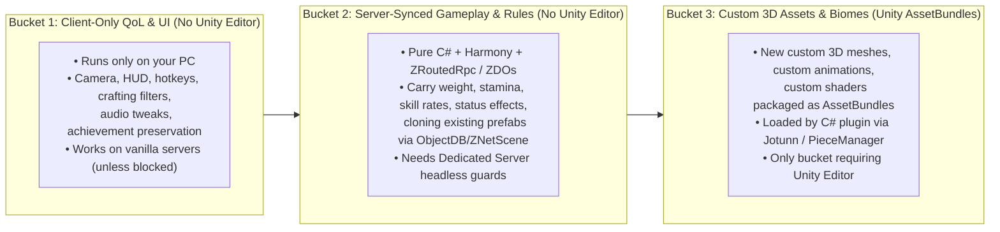

# Valheim 1.0 Modding 101 — The 15-Minute First Win & Prosumer Starter Kit

[-38bdf8?style=for-the-badge)](https://www.valheimgame.com/)
[](https://valheim.thunderstore.io/package/denikson/BepInExPack_Valheim/)
[-10b981?style=for-the-badge)](#)
[](#)
[](LICENSE)

> **Built for Valheim `1.0.0` – `1.0.20` (*Deep North*). Zero Unity Editor bloat. Zero risk to your saves or Steam account. Designed for tired humans at 11:30 PM.**

If you tried learning Valheim modding from YouTube or search results lately, you probably hit a wall of outdated 2021–2023 videos (`0.217`–`0.218`) with conflicting folder setups, broken method signatures, and zero guidance for modern Linux / SteamOS or AI-assisted workflows.

**This repository is the clean, up-to-date front door.** Inspired by Valve's *Portal* Test Chamber design philosophy, it gets your first real C# mod compiled, loaded, and verified inside Valheim `1.0.20` in **15 minutes flat**—before teaching you how to read Harmony stack traces, hot-reload `.cfg` files live without restarting the game, and write multiplayer-safe hooks.

---

## ⚡ Choose Your Path in 30 Seconds

Every developer and hobbyist works differently. Pick the lane that matches your setup tonight:

| Path | Best For | AI Spend | How to Start Right Now |
| :--- | :--- | :---: | :--- |
| **🤖 Path A: Point a CLI Agent** | Users of **Claude Code, Codex, Cursor, Windsurf, Antigravity**, or **Local Ollama** (`qwen2.5-coder`) | `$0` (Local) or Paid CLI | Clone this repo, open your agent in this folder, and say:<br/>**`"Walk me through building my first Valheim 1.0 mod."`**<br/>*(Your agent will automatically read [`AGENTS.md`](AGENTS.md) and run the preflight check!)* |
| **🖥️ Path B: Interactive Web Workbench** | Dual-monitor (`50%` window snap beside VS Code/Rider), **Ultrawide (`21:9` / `32:9`)**, or **Free Web ChatGPT** users | **$0** | Open **[`site/index.html`](site/index.html)** in your browser. Toggle **Windows vs. Linux**, pick your background lens, and use the **🤖 1-Click Self-Tap AI Prompt** button on any step if you get stuck. |
| **⌨️ Path C: Pure Deterministic CLI** | Developers & modders who just want clean, fast scripts with zero AI | **$0** | Run the 3 commands in the **60-Second CLI Quickstart** below. |

---

## 🚀 60-Second CLI Quickstart (Windows PowerShell & Linux Bash)

### 🪟 Windows (PowerShell)
```powershell
# 1. Clone the repository
git clone https://github.com/djcdevelopment/valheim-modding-101.git
cd valheim-modding-101

# 2. Chamber 1: Run the read-only 30-second environment check
.\tools\doctor.ps1

# 3. Chamber 2: Compile HelloValheim.dll (~12 KB) and deploy to BepInEx/plugins/
.\tools\build-and-deploy.ps1

# Undo anytime in 1 second (returns your game to 100% prior state):
.\tools\build-and-deploy.ps1 -Reset
```

### 🐧 Linux / SteamOS / CachyOS (Bash)
```bash
# 1. Clone the repository
git clone https://github.com/djcdevelopment/valheim-modding-101.git
cd valheim-modding-101

# 2. Chamber 1: Run the read-only 30-second environment check (catches the Steam #747 / Proton traps!)
bash tools/doctor.sh

# 3. Chamber 2: Compile HelloValheim.dll (~12 KB) and deploy to BepInEx/plugins/
bash tools/build-and-deploy.sh

# Undo anytime in 1 second (returns your game to 100% prior state):
bash tools/build-and-deploy.sh --reset
```

Once deployed, launch Valheim with `-console` in Steam Launch Options, press **`F5`** at the main menu, and type:
```text
vikingping
```
You will immediately see:
```text
[HelloValheim] Skål! Your first Valheim 1.0.20 mod is alive!
```

---

## 🧭 Chamber 0 Preview: The 3-Bucket Valheim Mod Taxonomy

Before writing code, it helps to know that **80%+ of Valheim mods never open the Unity Editor**. They are lightweight `.NET 4.8` C# class libraries (`10–50 KB`) that hook game methods at runtime using **HarmonyX**:



---

## 🧪 The 8-Chamber Curriculum (Paced for Your Energy Tonight)

Every step is designed around **Valve's Test Chamber Principles**: clear time & cognitive lift badges, observable **Green Sightlines**, proactive **Cliff-Edge Telemetry** (*"Where Missteps Go Poorly & How You'll Know"*), and explicit **🛑 Safe Stopping Points**.

| Sprint | Chamber | Duration & Lift | What You Build & Verify |
| :--- | :--- | :---: | :--- |
| **⚡ Sprint 1: First Safe Win (15 Mins)** | **Chamber 0:** *Demystifying Valheim 1.0 & The 3-Bucket Taxonomy* | `⏱️ 2m · 🟢 Low` | How `Doorstop -> BepInEx -> Harmony -> Valheim` works, why your saves and Steam account are 100% safe, and which bucket your mod idea belongs to. |
| **⚡ Sprint 1** | **Chamber 1:** *The 30-Second Preflight Check (`doctor`)* | `⏱️ 3m · 🟢 Low` | Verify `assembly_valheim.dll`, BepInEx `5.4.2202`, `.NET SDK`, and defeat the Linux Steam Play (`start_game_bepinex.sh %command%`) & Proton traps before touching C#. |
| **⚡ Sprint 1** | **Chamber 2:** *Clone & First Compile in 60 Seconds* | `⏱️ 4m · 🟢 Low` | Compile [`starter-mod/HelloValheim.csproj`](starter-mod/HelloValheim.csproj) with `<Private>false</Private>` so zero Unity DLLs leak into `plugins/`. **🛑 Safe Stop #1.** |
| **⚡ Sprint 1** | **Chamber 3:** *Seeing Your Code Inside Valheim* | `⏱️ 5m · 🟢 Low` | Boot with `-console`, confirm `[Info : BepInEx] Loading [HelloValheim 1.0.0]` in `LogOutput.log`, and run `vikingping` in `F5`. **🏆 Safe Stop #2 (First Win Complete!).** |
| **🛠️ Sprint 2: Real Mod Engineering (30 Mins)** | **Chamber 3.5:** *Troubleshooting, 1.0.20 Stack Traces & IDE Debugging* | `⏱️ 7m · 🟡 Med` | Decode `(wrapper dynamic-method) Player.DMD<Player::GetMaxCarryWeight>` frames in `LogOutput.log`, prevent `Player.m_localPlayer == null` scene-load NREs, use `[HarmonyFinalizer]`, and attach Rider/VS Code breakpoints (`127.0.0.1:10000`). |
| **🛠️ Sprint 2** | **Chamber 4:** *Harmony Prefix/Postfix & The 1.0.20 Breaking Shifts* | `⏱️ 8m · 🟡 Med` | Boost carry weight via `[HarmonyPostfix]` on `Player.GetMaxCarryWeight`, preserve Steam achievements via scoped state-passing on `Achievements.IsCheatedAtAll`, and master the **6 Valheim 1.0.20 Architectural Shifts**. |
| **🛠️ Sprint 2** | **Chamber 4.5:** *BepInEx `Config.Bind` & Live Hot-Reload* | `⏱️ 4m · 🟢 Low` | Bind `ConfigEntry<float>` with `AcceptableValueRange<float>(0f, 1000f)` and a `FileSystemWatcher` so editing your `.cfg` file updates carry weight in-game **live without restarting**. **🛑 Safe Stop #3.** |
| **🚀 Deep Dive** | **Chamber 5:** *Multiplayer ZDOs, Dedicated Servers, ILSpy & Thunderstore* | `⏱️ 12m · 🟡 Med` | Protect headless Linux/Windows Dedicated Servers (`ZNet.instance.IsDedicated()`), understand distributed `ZNetView.IsOwner()`, register a `ZRoutedRpc` handler, inspect `assembly_valheim.dll` in ILSpy, and package for Thunderstore. |

---

## 📦 What's Inside `starter-mod/HelloValheimPlugin.cs`?

Our starter plugin ([`starter-mod/HelloValheimPlugin.cs`](starter-mod/HelloValheimPlugin.cs)) is not a throwaway `Debug.Log("Hello World")` stub. It contains **5 progressive, heavily commented, production-grade Valheim `1.0.20` lessons** in a single ~15 KB assembly:

1. **Lesson 1 (Instant Console Telemetry):** Registers `vikingping` and `vikinginspect` in `Terminal.ConsoleCommand` for instant runtime verification.
2. **Lesson 2 (`ConfigEntry<T>` + Live `.cfg` Hot-Reload):** Uses `Config.Bind` with `AcceptableValueRange` (auto-rendering sliders in `BepInEx.ConfigurationManager`) plus a debounced `FileSystemWatcher` on `BepInEx/config/`.
3. **Lesson 3 (Harmony Postfix + Fault-Isolating Finalizer):** Patches `Player.GetMaxCarryWeight` to add your configured carry bonus and wraps it in a `[HarmonyFinalizer]` that safely catches and logs any runtime exception once.
4. **Lesson 4 (Valheim 1.0 Scoped State-Passing Pattern):** Demonstrates `[HarmonyPrefix]`, `[HarmonyPostfix]`, and `[HarmonyFinalizer]` with `struct State` on `Achievements.IsCheatedAtAll()`—preserving vanilla cheat checks while preventing `Game.isModded` from blocking legitimate Steam achievements.
5. **Lesson 5 (Multiplayer & Headless Dedicated Server Guard):** Demonstrates `ZNet.instance.IsDedicated()` safety and registers a minimal `ZRoutedRpc` message (`HelloValheim_Ping`) when joining a world.

---

## 📐 Product Architecture & Valve Playtest Documentation (`product/`)

Want to see how this guide and workbench were engineered, or explore the complete **Valheim 1.0.20 Cliff-Edge Telemetry Matrix**?

- **[`00-PRODUCT-VISION-AND-ROADMAP.md`](product/00-PRODUCT-VISION-AND-ROADMAP.md)** — Market thesis, Valve *Portal* pedagogy, `< 5 min` patch maintenance economics, and the roadmap for our upcoming **5-Part "Behind the Curtain" Engineering Series**:
  1. *Part 1: Zero-Copy NTFS Junction & POSIX Symlink Profile Engine (`< 50ms` switching)*
  2. *Part 2: Sub-8-Second Autonomous Valheim Fast-Boot Harness*
  3. *Part 3: 3-Second `Mono.Cecil` Bytecode Preflight Auditing Across 50+ Mods*
  4. *Part 4: Resilient Harmony IL Transpilers & Closure Matching in Valheim 1.0*
  5. *Part 5: Zero-Drift Thunderstore CI/CD Packaging*
- **[`01-CUSTOMER-PERSONAS-AND-ECONOMICS.md`](product/01-CUSTOMER-PERSONAS-AND-ECONOMICS.md)** — The 3-Axis Customer Model (Background `P1`–`P5` × AI Posture `AI-0`–`AI-3` × 11:30 PM Cognitive Battery).
- **[`02-VALVE-PLAYTEST-DESIGN-RULES.md`](product/02-VALVE-PLAYTEST-DESIGN-RULES.md)** — The 7 Valve Tutorial Design Laws and the 11-row **Valheim 1.0.20 Cliff-Edge Telemetry Matrix**.
- **[`03-USER-FLOWS-AND-STATE-MACHINE.md`](product/03-USER-FLOWS-AND-STATE-MACHINE.md)** — End-to-end Mermaid sequence diagrams for CLI Agents, Manual CLI, the 1-Click Self-Tap Web AI Recovery Loop, and the 8-Chamber State Machine.
- **[`04-PROSUMER-RESPONSIVE-SPEC.md`](product/04-PROSUMER-RESPONSIVE-SPEC.md)** — Responsive grid specification for `32:9` / `21:9` Ultrawide, 4K Studio, and **50% Half-Screen IDE Window Snap (`960px–1599px`)**.

---

## 📜 License

Released under the **[MIT License](LICENSE)**. You are free to fork, modify, embed snippets into your own mods, and publish your creations to Thunderstore or Nexus Mods. *Skål!*
