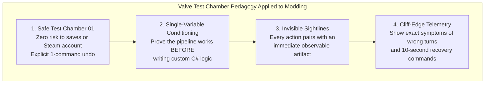
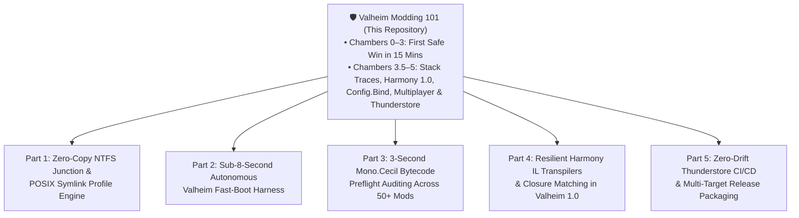

# 00 — Product Vision, Market Thesis & Engineering Series Roadmap

> **Status:** Active Product Specification (Rev 2)  
> **Target Engine:** Valheim `1.0.0` – `1.0.20` (*Deep North*) · `.NET Framework 4.8` (`net48`) · BepInEx `5.4.2202` · HarmonyX `2.9.0`  
> **Maintenance SLA:** `< 5 minutes` per Iron Gate game patch via automated `Mono.Cecil` reflection auditing

---

## 1. Executive Thesis: The Post-1.0 Modding "Second Wind"

When a landmark survival game reaches `1.0` (*Deep North*, currently `1.0.20`), its modding ecosystem undergoes a structural phase transition:

1. **The Launch Rush Settles, The Builders Arrive:** The initial launch week is dominated by players rushing new biome content and veteran mod authors scrambling to fix broken `0.217`–`0.218` plugins. Once that wave stabilizes, a **second, larger wave of aspiring creators** arrives—software developers, Minecraft/Skyrim/Factorio modders, server administrators, and curious players who realize Valheim's API is finally stable enough to invest in learning.
2. **The Search & YouTube Documentation Vacuum (The *"WaitAMinute"* Signal):** When these new and returning creators search Google, YouTube, or ask standard LLMs how to make a Valheim mod, they hit a minefield of stale 2021–2023 tutorials:
   - Outdated YouTube videos showing deprecated folder structures, manual DLL copying into `valheim_Data/Managed/`, or broken Visual Studio 2019 templates.
   - Pre-1.0 method signatures that immediately fail to compile or throw `AmbiguousMatchException` / `NullReferenceException` at runtime in `1.0.20` (e.g., `Vector2i` replaced by `Vector2s` in `ZDOMan`, `SEMan.AddStatusEffect` requiring a 5th `short variant` parameter, `PieceTable.SetCategory` overload ambiguity, and `Utils.GetSaveDataPath()` crashing inside `Awake()`).
   - Unclear platform guidance for Linux / SteamOS / CachyOS modders hitting the Steam Play `#747` launch trap (`start_game_bepinex.sh %command%` vs. Proton `WINEDLLOVERRIDES`).

> [!IMPORTANT]
> **The Opportunity:** By packaging our battle-tested Valheim 1.0 engineering knowledge into an approachable, zero-friction, customer-centric **Modding 101 Guide & Starter Kit**, we establish the definitive community entry point—while keeping our heavy sovereign lab automation under the hood and teeing up a high-signal **5-Part "Behind the Curtain" Engineering Series**.

---

## 2. Valve Game Studios Customer-Centric Product Philosophy

Rather than writing a traditional wall-of-text wiki that blames the user when a step fails, this repository is engineered around **Valve's playtest and level-design principles** (*Half-Life 2* and *Portal* developer commentary):

### Core Design Pillars

1. **Condition Confidence in a Safe "Test Chamber 01" Before Introducing Danger:**
   - In *Portal*, players learn how portals work in a room where they cannot die before facing high-energy pellets.
   - In **Valheim Modding 101**, **Chambers 0–3** (*Sprint 1: First Safe Win in 15 Minutes*) prove the user's game folder, BepInEx loader, C# compiler (`dotnet build`), and in-game `F5` console (`vikingping`) work **before** asking the user to write custom Harmony patches or decompile game assemblies.
2. **Assume the User is Distracted, Tired, and Hungry at 11:30 PM:**
   - Hobbyist modding happens after work or classes. Long paragraphs of Unity engine theory drain cognitive battery before the user sees a single line of code run in-game.
   - Every step opens with an **Expectation Header** (`⏱️ Time · 🧠 Cognitive Lift · 🛑 Safe Stop Indicator · ↩️ 1-Command Undo`) and caps introductory prose at 3–4 sentences before a concrete action.
3. **Tri-Modal Traction (Meet Every User Where They Work):**
   - **Mode A — Autonomous CLI Agent (`AGENTS.md` / `CLAUDE.md`):** Clone the repo and point Claude Code, Codex, Cursor, Windsurf, Antigravity, or a local Ollama agent at the workspace for an interactive guided tutor.
   - **Mode B — Deterministic No-AI CLI & Visual Workbench (`tools/` + `site/`):** First-class Windows PowerShell (`doctor.ps1`, `build-and-deploy.ps1`) and Linux Bash (`doctor.sh`, `build-and-deploy.sh`) scripts paired with an ultrawide/half-screen responsive web workbench.
   - **Mode C — 1-Click "Self-Tap" AI Context Capsules ($0 Spend):** Every step includes a **🤖 Copy AI Self-Tap Prompt** button that bundles the exact Valheim `1.0.20` ground-truth signatures and user OS so even Free Web ChatGPT or Claude can troubleshoot errors without hallucinating 2022 code.
4. **Prosumer Desktop Ergonomics:**
   - PC modders overwhelmingly use ultrawide monitors (`21:9` / `32:9`), dual-monitor 1440p/4K setups, or **50% half-screen window snaps** (`960px–1599px`) beside VS Code, JetBrains Rider, or a terminal. Our web workbench (`site/`) is purpose-built for these viewports.

---

## 3. Near-Zero Maintenance Economics (`< 5 Minutes` Per Game Patch)

Most community tutorials rot within six months because maintaining screenshots, code snippets, and method signatures across game updates is manual labor. **Valheim Modding 101** is designed for near-zero ongoing maintenance by riding on top of our existing automated compatibility infrastructure:

| Maintenance Vector | Why Traditional Guides Rot | How `valheim-modding-101` Stays Evergreen in `< 5 Mins` |
| :--- | :--- | :--- |
| **Game Assembly Signatures (`assembly_valheim.dll`)** | Author manually checks if `Player.GetMaxCarryWeight` or `SEMan.AddStatusEffect` changed after a patch. | Automated `Mono.Cecil` target auditor scans `HelloValheim.dll` Harmony attributes against the new `valheim_Data/Managed/assembly_valheim.dll` in **< 3 seconds**. |
| **Starter Template Compilation** | Visual Studio `.csproj` hardcodes `C:\Program Files (x86)\...` paths that break across machines. | `starter-mod/HelloValheim.csproj` auto-resolves `$(ValheimDir)` across Windows & Linux Steam libraries and enforces `<Private>false</Private>` so game DLLs never leak. |
| **Cross-Platform Boot Verification** | Author manually tests Windows and forgets Linux/SteamOS or vice versa. | `tools/doctor.{sh,ps1}` and `tools/build-and-deploy.{sh,ps1}` validate the entire build + deploy + `LogOutput.log` contract headless or in fast-boot mode. |
| **LLM Hallucination Drift** | Users ask ChatGPT and get broken `0.217` answers. | Pinned `1.0.20` API ground-truth capsules in `AGENTS.md` and `site/steps-data.js` keep both frontier agents and free web chatbots locked to verified signatures. |

---

## 4. Separation of Concerns: Day-1 Simplicity vs. The 5-Part Engineering Series

To keep **Valheim Modding 101** approachable for a first-time modder on a Tuesday night, we intentionally **do not** force learners to install our full 51-mod sovereign testing harness on Day 1. Instead, the guide gives them a clean, rock-solid foundation (`Chambers 0–5`) and concludes with a gateway into the **"Behind the Curtain" 5-Part Engineering Series**:

### The 5-Part "Behind the Curtain" Engineering Series Roadmap

#### Part 1: The Zero-Copy Profile Engine (NTFS Junctions & POSIX Symlinks)
- **The Problem:** Mod managers like r2modman and Gale duplicate or hardlink gigabytes of files across profiles, and on Linux (`CachyOS` / `SteamOS`), Steam's `pressure-vessel` container strips `LD_PRELOAD` when launching out-of-tree profiles (`FAQ-006`).
- **What We Teach:** How to switch between **100% Vanilla**, **Single-Mod Dev Isolation**, and **50-Mod Production Packs** in **< 50 milliseconds** using atomic directory junctions on Windows and in-tree POSIX symlinks on Linux—with zero file duplication and guaranteed clean restores.

#### Part 2: The Sub-8-Second Autonomous Fast-Boot & Log Telemetry Loop
- **The Problem:** Waiting 90–240 seconds for Valheim splash screens, `FejdStartup` cinematics, and manual world loading destroys developer flow state during iterative debugging.
- **What We Teach:** How to bypass intro cinematics during development (`LetMePlay` pattern), auto-launch into a deterministic test harness with `-console`, tail `BepInEx/LogOutput.log` programmatically, and assert `0 HarmonyException / 0 TypeLoadException` in under 8 seconds.

#### Part 3: 3-Second `Mono.Cecil` Bytecode Preflight Auditing (Catching Patch Breaks Before Booting)
- **The Problem:** When Iron Gate releases a hotfix (`1.0.20` -> `1.0.21`), booting the game to see which of your 40 mods crashes at runtime is slow and misses lazy-evaluated code paths.
- **What We Teach:** Building a standalone CLI verifier using `Mono.Cecil` (modeled on `Verify-IsModded`) that inspects every `[HarmonyPatch]` target and CIL `ldsfld`/`callvirt` instruction in your compiled mod DLLs against the new `assembly_valheim.dll` in 3 seconds flat.

#### Part 4: Resilient Harmony IL Transpilers & Compiler Closure Lowering in Valheim 1.0
- **The Problem:** Hardcoded local variable indices (`V_13` -> `V_12` in `ZDOMan.RPC_ZDOData`), reversed key-check evaluation order (`GameCamera.UpdateMouseCapture`), and C# compiler closure renames (`<OnNewChatMessage>b__0` -> `<OnNewChatMessage>g__OnCheckPermissionAsyncCompleted|0`) break fragile transpilers.
- **What We Teach:** Defensive `CodeMatcher` patterns (`.Start()` resets, dynamic local resolution, graceful no-op fallbacks when `matcher.IsValid == false`, and multi-candidate `[HarmonyTargetMethod]` reflection).

#### Part 5: Zero-Drift Thunderstore Packaging & Multi-OS Release Verification
- **The Problem:** Missing `icon.png` dimensions (`256x256`), mismatched `manifest.json` vs. `[BepInPlugin]` semantic versions, and accidentally bundling `UnityEngine.dll` inside a release `.zip`.
- **What We Teach:** Single-command `tcli` / `thunderstore.toml` packaging with automated artifact size gates (`< 50 KB` pure plugin check), assembly hash receipts, and reproducible compatibility tables.

---

## 5. Product Suite Index (`product/`)

| Document | Focus & Purpose |
| :--- | :--- |
| **[`00-PRODUCT-VISION-AND-ROADMAP.md`](file:///home/derek/work/valheim-modding-101/product/00-PRODUCT-VISION-AND-ROADMAP.md)** | Executive thesis, Valve pedagogy, `<5 min` maintenance economics, and the 5-Part Engineering Series roadmap. |
| **[`01-CUSTOMER-PERSONAS-AND-ECONOMICS.md`](file:///home/derek/work/valheim-modding-101/product/01-CUSTOMER-PERSONAS-AND-ECONOMICS.md)** | 3-axis customer model (Background/Goal × AI Posture/Spend × 11:30 PM Cognitive Battery) and persona success matrices. |
| **[`02-VALVE-PLAYTEST-DESIGN-RULES.md`](file:///home/derek/work/valheim-modding-101/product/02-VALVE-PLAYTEST-DESIGN-RULES.md)** | The 7 Valve Tutorial Design Laws and the complete **Valheim 1.0.20 Cliff-Edge Telemetry Matrix**. |
| **[`03-USER-FLOWS-AND-STATE-MACHINE.md`](file:///home/derek/work/valheim-modding-101/product/03-USER-FLOWS-AND-STATE-MACHINE.md)** | End-to-end Mermaid sequence and state diagrams for Agent-Guided, Manual CLI, Self-Tap Web AI recovery, and the 8 Chambers. |
| **[`04-PROSUMER-RESPONSIVE-SPEC.md`](file:///home/derek/work/valheim-modding-101/product/04-PROSUMER-RESPONSIVE-SPEC.md)** | Responsive layout specification for `32:9`/`21:9` Ultrawide, 4K Studio, 50% Half-Screen IDE Snap, and Portrait Secondary displays. |
