# 01 — Customer Personas, AI Postures & Cognitive Economics

> **Core Premise:** A tutorial that assumes every reader has the same coding background, the same AI toolset, and four hours of uninterrupted Saturday morning focus will lose 80% of its audience by Step 2. We model our learners across **three orthogonal axes** so every person finds an immediate, high-traction path.

---

## 1. The 3-Axis Customer Model

```mermaid
flowchart TD
    subgraph Axis1 ["Axis 1: Background & Goal State (Who They Are)"]
        P1["P1: Prior Modder in Other Game\n('The WaitAMinute Archetype')\nMinecraft / Skyrim / Factorio\nHas mental model; burned by stale 2022 videos"]
        P2["P2: Software Developer\n(Backend / Full-Stack / Systems)\n0 Unity experience; wants CLI + IDE debugger,\nzero 15GB Unity Editor GUI bloat"]
        P3["P3: Goal-Driven Hobbyist\n(Has 1 Specific Itch Tonight)\nWants to tweak carry weight, stamina, or fix\na broken mod in 15 mins without a CS degree"]
        P4["P4: Curious Explorer\n(Wants to Learn, No Goal Yet)\nAfraid of breaking saves/achievements;\nneeds curated starter recipes & fast dopamine"]
        P5["P5: Returning Pre-1.0 Modder\n(0.217-0.218 Author / Server Admin)\nNeeds 1.0.20 breaking signature table,\nDMD<> stack trace triage & Dedicated guards"]
    end

    subgraph Axis2 ["Axis 2: AI Posture & Frontier Spend (How They Work)"]
        AI0["AI-0: Pure Manual ($0 AI Spend)\nDeterministic PowerShell / Bash scripts\n+ Annotated Visual Sightlines"]
        AI1["AI-1: Free Web Chat ($0 Spend)\nChatGPT / Claude / DeepSeek Web\nUses 1-Click Self-Tap Context Capsules"]
        AI2["AI-2: Local Prosumer GPU AI ($0 Cloud)\nOllama / vLLM / LM Studio (12-24GB VRAM)\nqwen2.5-coder:14b/30b + Pinned Context"]
        AI3["AI-3: Paid Frontier CLI Agent ($20-$200/mo)\nClaude Code / Codex / Cursor / Antigravity\nPoints agent directly at AGENTS.md"]
    end

    subgraph Axis3 ["Axis 3: Time & Cognitive Battery Tonight (11:30 PM Reality)"]
        T1["⚡ Sprint 1: 15-Min First Safe Win\n(Chambers 0 -> 3)\nDistracted, tired, hungry -> Build, boot,\nrun F5 'vikingping', clean safe stop"]
        T2["🛠️ Sprint 2: 45-Min Focused Build\n(Chambers 3.5 -> 4.5)\nStack trace decoding, Harmony Postfix,\nConfig.Bind + live .cfg hot-reload"]
        T3["🚀 Weekend Deep Dive\n(Chamber 5 + Engineering Series)\nMultiplayer ZRoutedRpc, Dedicated Server\nguards, ILSpy & Thunderstore packaging"]
    end

    Axis1 --> Axis2 --> Axis3
```

---

## 2. Axis 1 Deep Dive: Background & Goal State Profiles (`P1`–`P5`)

| ID | Persona Archetype | Prior Mental Model | Primary Anxiety or Friction | Time Available Tonight | Willingness to Invest | What Delivers an Instant "Aha!" Moment |
| :--- | :--- | :--- | :--- | :--- | :--- | :--- |
| **`P1`** | **Prior Modder in Another Game** (*The "WaitAMinute" Discord Archetype — Minecraft Forge/Fabric, Skyrim SKSE, Factorio*) | Understands hooks, event buses, mod loaders, and config files. | Watched 3 YouTube tutorials from 2021–2023 showing conflicting folder setups and `0.217` methods that fail in `1.0.20`. | `30–60 mins` | **High (`4–10+ hrs`)** once they verify this guide is genuinely updated for `1.0.20`. | Seeing the **3-Bucket Mod Taxonomy** in Chamber 0 and compiling `HelloValheim.dll` cleanly against `1.0.20` on the very first run. |
| **`P2`** | **Software Developer** (*Backend / Full-Stack / DevOps, 0 Unity Experience*) | Thinks in `git clone`, `dotnet build`, stack traces, breakpoints, and CI pipelines. | Assumes modding a Unity game requires downloading a 15 GB Unity Hub install and clicking around scene hierarchies. | `20–45 mins` | **Medium-High (`2–6 hrs`)** if the workflow stays in CLI + VS Code / Rider. | Discovering a Valheim mod is a **12 KB C# `.NET 4.8` class library** that compiles in **1.2 seconds** via CLI and supports live Mono breakpoint debugging (`127.0.0.1:10000`). |
| **`P3`** | **Goal-Driven Hobbyist** (*Wants to Learn & Has a Specific Goal Tonight*) | Knows what they want in-game (*"Give me +200 carry weight"*, *"Stop stamina drain while building"*), minimal C# background. | Intimidated by C# boilerplate, `.csproj` XML, and compiler errors; zero patience for abstract lectures. | `15–30 mins` (High fatigue) | **Low upfront (`15 mins`)**; expands dramatically after their first tweak works in-game. | Editing one number or `.cfg` line in `HelloValheimPlugin.cs`, running one script, and seeing their carry weight jump to `450` in-game. |
| **`P4`** | **Curious Explorer** (*Wants to Learn & Doesn't Have a Goal Yet*) | Loves Valheim, curious how mods work under the hood, wants a guided sandbox. | Blank-page paralysis (*"What should I even build?"*) + fear of corrupting their 300-hour world save or losing Steam achievements. | `15–30 mins` | **Exploratory** (driven by low-friction curiosity and visual feedback). | Explicit **Save & Achievement Safety Guarantee** (`IsModded` lesson) + 5 pre-wired, toggleable lessons they can experiment with immediately. |
| **`P5`** | **Returning Pre-1.0 Modder / Server Pack Admin** | Built mods or maintained server packs during `0.217` (*Hildir*) or `0.218` (*Ashlands*). | Mods compile or load with `AmbiguousMatchException`, `MissingMethodException`, or crash Dedicated Servers on `1.0.20`. | `15–45 mins` | **High** (needs authoritative reference data fast). | Jumping straight to **Chamber 3.5 (`DMD<>` Stack Traces)**, **Chamber 4 (The 6 Valheim 1.0.20 Architectural Shifts)**, and **Chamber 5 (`ZNet.instance.IsDedicated()`)**. |

### The "WaitAMinute" Signal (Why `P1` and `P2` Bounce Off Legacy Tutorials)

In community Discord channels, aspiring modders with real programming and Minecraft modding backgrounds repeatedly voice the exact same blocker:
- They watch 3 different beginner videos and see 3 different project setups.
- None of the videos explain **which references must be set to `<Private>false</Private>`**, why Linux Steam launch options silently ignore BepInEx when Proton or `pressure-vessel` interferes, or how Valheim `1.0.20` changed core signatures.
- **Our Fix:** Chamber 0 and Chamber 1 eliminate all environment ambiguity in under 5 minutes using deterministic `doctor.ps1` / `doctor.sh` checks before a single line of C# is edited.

---

## 3. Axis 2 Deep Dive: AI Posture & Frontier Spend Economics (`AI-0`–`AI-3`)

Modders in 2026 have wildly different preferences—and budgets—for AI tooling. **Valheim Modding 101** treats all four postures as first-class citizens without forcing any paid subscription:

| Posture ID | Tooling Archetype | Monthly AI Spend | Primary Risk / Failure Mode in Valheim 1.0 | How `valheim-modding-101` Sets Them Up to Succeed |
| :--- | :--- | :--- | :--- | :--- |
| **`AI-0`** | **Pure Manual / No-AI** (*CLI + Visual Sightlines*) | **$0 / mo** | Getting lost in implicit steps or cryptic terminal errors without an assistant to ask. | Every chamber provides exact **Windows PowerShell** and **Linux Bash** copy-paste blocks, visual file-tree state diagrams, and a **Cliff-Edge Telemetry Box** covering the top failure modes. |
| **`AI-1`** | **Free Web Chat** (*ChatGPT Free, Claude Free, DeepSeek Web*) | **$0 / mo** | Free browser models have a knowledge cutoff bias toward 2021–2023 Valheim (`0.217`) and hallucinate `Vector2i`, 4-arg `AddStatusEffect`, or Unity Editor workflows. | Every step features a **🤖 1-Click Self-Tap AI Prompt** button that copies a self-contained prompt pre-loaded with Valheim `1.0.20` API constraints, the step's exact code, and a place to paste their error log. |
| **`AI-2`** | **Local Prosumer GPU AI** (*Ollama, vLLM, LM Studio on RTX 3080/4070/4090 or Radeon RX 7900 / Arc B70 — `12GB–24GB VRAM`*) | **$0 Cloud Spend** (Own Hardware) | Local `14B–32B` coding models (`qwen2.5-coder:14b`, `deepseek-coder-v2`, `gemma-3-27b`) excel when context is tight (<4k tokens) but drift if fed bloated docs. | Compact, token-efficient context blocks in `AGENTS.md` and `starter-mod/HelloValheimPlugin.cs` allow a local 14B/27B model to act as an accurate, zero-latency coding partner. |
| **`AI-3`** | **Paid Frontier CLI Agent** (*Claude Code, OpenAI Codex CLI, Cursor, Windsurf, Google Antigravity*) | **$20 – $200 / mo** | Without a repo contract, frontier agents over-engineer, run slow blind searches across `Managed/`, or forget `<Private>false</Private>`. | Root [`AGENTS.md`](file:///home/derek/work/valheim-modding-101/AGENTS.md) and [`CLAUDE.md`](file:///home/derek/work/valheim-modding-101/CLAUDE.md) turn the agent into an interactive **Valve Test Chamber Tutor** that runs `tools/doctor`, asks the user's goal & time budget, and verifies builds automatically. |

---

## 4. Axis 3 Deep Dive: The 11:30 PM Cognitive Battery Model

> [!WARNING]
> **The 11:30 PM Design Constraint:** Assume the user is sitting down at **11:30 PM after a long day**. They are **slightly distracted, tired, and hungry**. If a step requires reading 800 words of prose, hunting through five nested folders for a DLL, and guessing why a build failed, they will close the tab and never come back.

We structure the entire curriculum around **three explicit energy & time envelopes**, with guilt-free **🛑 Safe Stopping Points** built directly into the progression:

```mermaid
flowchart LR
    subgraph Sprint1 ["⚡ Sprint 1: The 15-Minute First Safe Win (Low Cognitive Lift)"]
        direction LR
        S0["Chamber 0 (2m)\nDemystify & 3-Bucket\nMod Taxonomy"] --> S1["Chamber 1 (3m)\nRun doctor.ps1/.sh\nPreflight Check"]
        S1 --> S2["Chamber 2 (4m)\nFirst Compile\nHelloValheim.dll\n🛑 SAFE STOP #1"]
        S2 --> S3["Chamber 3 (5m)\nBoot & Run F5\n'vikingping' In-Game\n🛑 SAFE STOP #2"]
    end

    subgraph Sprint2 ["🛠️ Sprint 2: 30-Minute Real Mod Engineering (Medium Lift)"]
        direction LR
        S35["Chamber 3.5 (7m)\n1.0 Stack Traces (DMD<>)\n& Live IDE Breakpoints"] --> S4["Chamber 4 (8m)\nHarmony Prefix/Postfix\n& 1.0.20 6-Shift Map"]
        S4 --> S45["Chamber 4.5 (4m)\nConfig.Bind Sliders &\nLive .cfg Hot-Reload\n🛑 SAFE STOP #3"]
    end

    subgraph Sprint3 ["🚀 Weekend Deep Dive: Multiplayer & Publishing (Focused Lift)"]
        direction LR
        S5["Chamber 5 (12m)\nDedicated Server Guards,\nZRoutedRpc, ILSpy & Thunderstore"]
    end

    Sprint1 --> Sprint2 --> Sprint3
```

### Cognitive Budget Allocation by Chamber

| Chamber | Target Duration | Cognitive Lift | What the User Actually Does | Dopamine / Verification Payoff | Safe to Stop Here? |
| :--- | :---: | :---: | :--- | :--- | :---: |
| **Chamber 0:** *Demystifying Valheim 1.0 & Mod Taxonomy* | `2 mins` | 🟢 **Low** | Reads the 4-stage load chain (`Doorstop -> BepInEx -> Harmony -> Valheim`) and identifies if their mod idea is **Bucket 1 (Client)**, **Bucket 2 (Server-Synced)**, or **Bucket 3 (AssetBundle)**. | Realizes their save files and Steam account are 100% safe and 80% of mods never touch Unity Editor. | Yes |
| **Chamber 1:** *The 30-Second Preflight Check* | `3 mins` | 🟢 **Low** | Runs `.\tools\doctor.ps1` (Windows) or `bash tools/doctor.sh` (Linux). | Sees green `[PASS]` checkmarks confirming `assembly_valheim.dll`, BepInEx `5.4.2202`, and `.NET SDK`. | Yes |
| **Chamber 2:** *Clone & First Compile in 60 Seconds* | `4 mins` | 🟢 **Low** | Runs `build-and-deploy.ps1` / `.sh` (or `dotnet build -c Release`). | Sees `Build succeeded. 0 Warning(s). 0 Error(s)` and a clean ~12 KB `HelloValheim.dll` deployed to `BepInEx/plugins/`. | **🛑 Safe Stop #1** |
| **Chamber 3:** *Seeing Your Code Inside Valheim* | `5 mins` | 🟢 **Low** | Launches Valheim with `-console`, presses `F5`, and types `vikingping`. | Sees `[HelloValheim] Skål! Your first Valheim 1.0.20 mod is alive!` printed live inside the game console. | **🛑 Safe Stop #2 (First Win!)** |
| **Chamber 3.5:** *Stack Traces (`DMD<>`) & IDE Debugging* | `7 mins` | 🟡 **Medium** | Runs `vikinginspect` in `F5`, reads a real Harmony `DMD<Player::GetMaxCarryWeight>` stack frame, and optionally connects Rider/VS Code debugger to `127.0.0.1:10000`. | Never fears a red wall of text in `LogOutput.log` again; knows how to tell which mod hooked a crashing method in 5 seconds. | Yes |
| **Chamber 4:** *Harmony Patches & 1.0.20 Breaking Shifts* | `8 mins` | 🟡 **Medium** | Examines how `[HarmonyPostfix]` boosts `Player.GetMaxCarryWeight` (`+150f`) and how `[HarmonyPrefix]`/`[HarmonyFinalizer]` decouple `Game.isModded` in `Achievements.IsCheatedAtAll`. | Carries `450` weight in-game with Steam achievements intact, plus owns the **6-Shift 1.0.20 Migration Cheat Sheet**. | Yes |
| **Chamber 4.5:** *BepInEx `Config.Bind` & Live Hot-Reload* | `4 mins` | 🟢 **Low** | Opens `BepInEx/config/com.valheimmodding101.hellovalheim.cfg` while the game is running, changes `CarryWeightBonus = 500`, and saves the file. | Watches their in-game max carry weight update from `450` to `800` **instantly without restarting Valheim**. | **🛑 Safe Stop #3** |
| **Chamber 5:** *Multiplayer ZDOs, Dedicated Servers, ILSpy & Thunderstore* | `12 mins` | 🟡 **Medium** | Reviews `ZNet.instance.IsDedicated()` guards, `ZNetView.IsOwner()`, a 12-line `ZRoutedRpc` broadcast, ILSpy method discovery, and `manifest.json` packaging. | Ready to run mods safely on Linux Dedicated Servers and publish their first package to Thunderstore. | **🏁 Course Complete!** |
