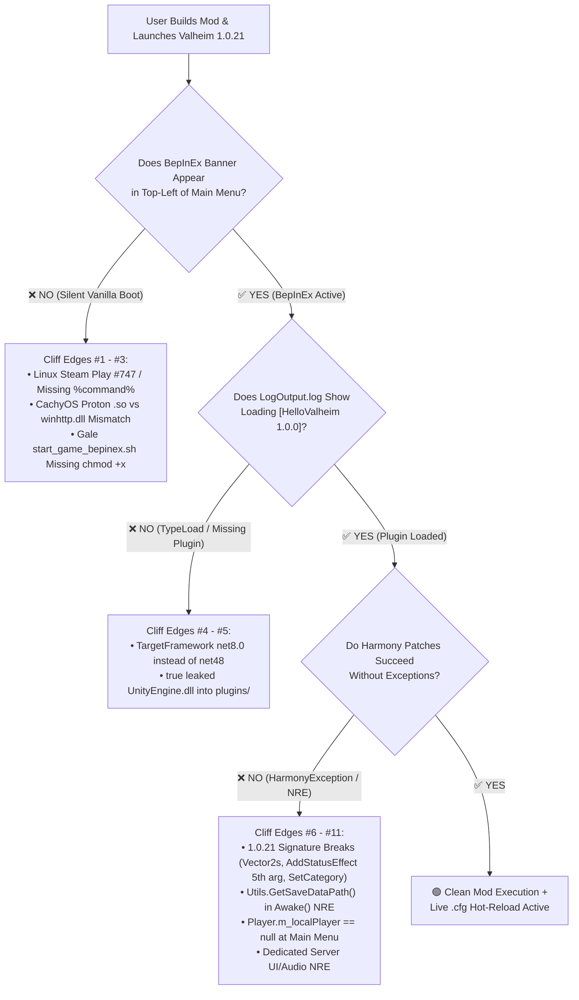

# 02 — Valve Playtest Design Rules & The Valheim 1.0.21 Cliff-Edge Telemetry Matrix

> **Design Philosophy:** In *Half-Life 2* and *Portal*, when playtesters walked the wrong way or died repeatedly in a puzzle room, Valve never blamed the player—they fixed the lighting, adjusted the sightlines, and placed unmistakable visual and audio feedback right at the cliff edge. This document codifies the **7 Tutorial Design Laws** and the complete **Valheim 1.0.21 Cliff-Edge Telemetry Matrix** governing every file in this repository.

---

## 1. The 7 Valve-Inspired Tutorial Design Laws

### Law 1: Safe Test Chamber 01 (Zero Destructive Risk Before First Win)
- A new learner's unspoken fear is: *"Will installing BepInEx or compiling a broken C# file corrupt my 300-hour world save, trigger a Steam VAC ban, or break my normal multiplayer sessions?"*
- **Implementation:** Chamber 0 addresses this immediately with concrete architectural facts:
  1. Valheim uses **zero Valve Anti-Cheat (VAC)**.
  2. World and character saves live in `AppData/LocalLow/IronGate/Valheim` (Windows) or `~/.config/unity3d/IronGate/Valheim` (Linux)—completely separate from `steamapps/common/Valheim/BepInEx/plugins/`, which is the only folder our build script touches.
  3. Steam achievements in `1.0.21` are only suppressed while `Game.isModded == true` in memory, and Lesson 4 (`Achievements.IsCheatedAtAll` scoped state patch, modeled on [`IsModded`](file:///mnt/omen-c-read/work/ismodded/README.md)) shows how legitimate players keep achievements active.

### Law 2: The Expectation Header Contract (Respect the 11:30 PM Brain)
- Every single chamber in `site/`, `README.md`, and `AGENTS.md` must begin with an explicit **Expectation Header**:
  ```text
  ⏱️ Time: 3 mins · 🧠 Cognitive Lift: Low · 🛑 Safe Stop After Step: Yes · ↩️ Undo: ./tools/build-and-deploy.sh --reset
  ```
- Learners always know how long a step takes, how much mental energy it requires, whether they can go to bed right after finishing it, and how to undo it in one command.

### Law 3: Single-Variable Conditioning (Pipeline First, Custom Logic Second)
- Never ask a user to write custom C# code **and** configure their build pipeline for the first time in the same step. If it fails, they don't know whether their code is wrong, their `.csproj` is wrong, or BepInEx didn't load.
- **Implementation:**
  - **Chamber 1** verifies the environment (`doctor.ps1` / `doctor.sh`).
  - **Chamber 2** compiles our known-good `HelloValheim.csproj` untouched (`0 Warnings, 0 Errors`).
  - **Chamber 3** boots and runs `vikingping` to prove the end-to-end pipe works.
  - Only in **Chambers 3.5–4.5** does the user inspect stack traces, modify Harmony hooks, and live-reload config values.

### Law 4: Immediate Observable Sightlines (No Silent Steps)
- Every command the user runs must emit a deterministic, unmistakable **Green Sightline** output within seconds:
  - Running `doctor` prints `[PASS] Valheim 1.0.21 assembly_valheim.dll verified`.
  - Running `build-and-deploy` prints `[PASS] Output artifact size: 12.4 KB (Zero leaked Unity DLLs)`.
  - Booting Valheim prints `[Info   :HelloValheim] === Skål! HelloValheim 1.0.0 loaded on Valheim 1.0.21 ===` in `LogOutput.log`.

### Law 5: Tri-Modal Traction on Every Step
- Never lock a step behind a single workflow. Every chamber simultaneously supports:
  1. **⌨️ Terminal / CLI Copy-Paste** (Windows PowerShell + Linux Bash).
  2. **🤖 Autonomous CLI Agent** (`AGENTS.md` / `CLAUDE.md`).
  3. **💬 1-Click Self-Tap AI Prompt Capsule** for Free Web ChatGPT / Claude / Local Ollama.

### Law 6: Zero Destructive Operations & 1-Command Vanilla Reset
- No script in `tools/` ever overwrites vanilla game files in `valheim_Data/Managed/` or modifies user save directories.
- Running `.\tools\build-and-deploy.ps1 -Reset` or `bash tools/build-and-deploy.sh --reset` removes `BepInEx/plugins/HelloValheim/` in 1 second, returning the user's setup to its exact prior state.

### Law 7: Proactive Cliff-Edge Telemetry ("Where Missteps Go Poorly & How You'll Know")
- Instead of hiding troubleshooting in an appendix at the back of the manual, every step places a **Cliff-Edge Radar Box** directly below the action. It tells the user:
  - **The Early Warning Sign:** What you see (or *don't* see) in the first 10 seconds when you're heading off the cliff.
  - **Why It Happens:** The 1-sentence technical root cause.
  - **The 10-Second Recovery:** The exact command or toggle to fix it immediately.

---

## 2. The Valheim 1.0.21 Cliff-Edge Telemetry Matrix

This matrix synthesizes real-world failure modes across Windows, Linux (`CachyOS`, `SteamOS`, `Ubuntu`), BepInEx `5.4.2202`, and all 6 architectural shifts in Valheim `1.0.21` (*Deep North*).



### Complete Cliff-Edge Reference Table (Chambers 1–5)

| # | Chamber / Phase | Where Missteps Go Poorly (The Misstep) | How You'll Know You're Heading There (Early Symptom) | Root Cause in Valheim `1.0.21` | Deterministic 10-Second Fix |
| :-: | :--- | :--- | :--- | :--- | :--- |
| **1** | **Chamber 1:** *Linux Steam Launch* | Clicking Steam's green **Play** button on Linux without setting Launch Options (or using an out-of-tree Gale profile path). | Game boots cleanly to the main menu, zero errors, **no `BepInEx 5.4.2202` text in the top-left corner**, and `BepInEx/LogOutput.log` is not created or updated. | Steam's `pressure-vessel` container (`Steam Linux Runtime`) strips relative `LD_PRELOAD="libdoorstop_x64.so"` unless launched in-tree via `./start_game_bepinex.sh %command%` (`FAQ-006`). | Run `bash tools/doctor.sh` (which verifies symlinks and `chmod +x start_game_bepinex.sh`) and set Steam Launch Options to `./start_game_bepinex.sh %command%`. |
| **2** | **Chamber 1:** *Linux CachyOS / SteamOS Proton Mismatch* | Forcing **Proton Experimental / GE** in Steam Compatibility while using Linux `start_game_bepinex.sh` (or vice versa). | Game either fails to start within 2 seconds or boots completely vanilla ignoring all Linux `.so` preloads. | Proton runs the Windows PE binary (`valheim.exe`) under Wine, which cannot load Linux ELF `libdoorstop_x64.so`. Conversely, native `valheim.x86_64` ignores Windows `winhttp.dll`. | **Pick one lane:** Either uncheck *Force Steam Play compatibility tool* (Native Linux + `./start_game_bepinex.sh %command%`) **OR** keep Proton and set Launch Options to `WINEDLLOVERRIDES="winhttp=n,b" %command%`. |
| **3** | **Chamber 1 / 3:** *Direct CLI Launch Without Steam* | Running `./valheim.x86_64` or `valheim.exe` directly from a terminal when the Steam client is closed. | Game window flashes briefly and exits immediately, or `LogOutput.log` halts right after `[Steamworks.NET] SteamAPI_Init() failed`. | Valheim requires an active local Steam client IPC session (`SteamAppId 892970`) to initialize `Splatform` and `Steamworks`. | Keep the Steam desktop client open in the background, or launch via `steam steam://rungameid/892970`. |
| **4** | **Chamber 2:** *`.csproj` Target Framework Trap* | Creating a modern C# project targeting `net8.0` or `net9.0` instead of `net48` (or `netstandard2.0`). | `dotnet build` succeeds, but `BepInEx/LogOutput.log` prints `Could not load [HelloValheim.dll] because it targets a newer runtime (System.Runtime v8.0.0.0)`. | Valheim `1.0.21`'s Unity engine embeds a Mono runtime compatible with `.NET Framework 4.8` (`mscorlib 4.0.0.0`), even when you compile using `.NET SDK 8/9/10`. | Always keep `<TargetFramework>net48</TargetFramework>` and `<LangVersion>12</LangVersion>` in your `.csproj` (already configured in `starter-mod/HelloValheim.csproj`). |
| **5** | **Chamber 2:** *The `<Private>true</Private>` DLL Leak Trap* | Referencing `assembly_valheim.dll`, `UnityEngine.dll`, or `0Harmony.dll` in `.csproj` without `<Private>false</Private>`. | Your `BepInEx/plugins/HelloValheim/` folder suddenly contains **15–40 DLLs (`25+ MB`)** instead of **1 DLL (`~12 KB`)**, causing bizarre `TypeLoadException` or duplicate component crashes in-game. | By default, MSBuild copies every referenced assembly into the output folder. When BepInEx scans `plugins/`, it tries to load duplicate copies of `UnityEngine.dll` into the AppDomain. | Add `<Private>false</Private>` to every `<Reference>` in `.csproj`. Our `build-and-deploy` script automatically enforces a `< 50 KB` single-DLL gate and fails loudly if any Unity DLL leaks. |
| **6** | **Chamber 3.5:** *Scene-Transition `m_localPlayer` NRE* | Accessing `Player.m_localPlayer.GetInventory()` or `m_localPlayer.m_name` inside an `Update()` loop or global patch without a null guard. | `NullReferenceException` floods `LogOutput.log` at **60 FPS on the Main Menu** or while teleporting/respawning before the player prefab exists. | `Player.m_localPlayer` is `null` during the main menu (`FejdStartup`), world loading, and for ~3 seconds during death/respawn transitions. | Always start patches and `Update()` methods touching player state with: `if (Player.m_localPlayer == null) return;`. |
| **7** | **Chamber 3.5 / 4:** *`Utils.GetSaveDataPath()` in `Awake()` NRE* | Calling `Utils.GetSaveDataPath(FileHelpers.FileSource.Local)` inside your plugin's `Awake()` method on Valheim `1.0.21`. | Immediate `NullReferenceException` inside `FileHelpers.get_CloudStorageSupported()` during early BepInEx chainloader startup; your plugin crashes before registering its Harmony patches. | In Valheim `1.0`, `FileHelpers.CloudStorageSupported` checks `PlatformManager.DistributionPlatform.SaveDataProvider != null`, but `DistributionPlatform` is still `null` during `Awake()`. | Use `BepInEx.Paths.ConfigPath` for mod configs, or fallback safely to `Utils.persistantDataPath` inside a `try/catch` block if querying save paths early. |
| **8** | **Chamber 4:** *`PieceTable.SetCategory` Overload Ambiguity* | Writing `[HarmonyPatch(typeof(PieceTable), nameof(PieceTable.SetCategory))]` without specifying parameter types. | `HarmonyException: AmbiguousMatchException: Ambiguous match found for PieceTable.SetCategory` when `Harmony.PatchAll()` runs in `Awake()`. | Valheim `1.0` added a new strongly-typed enum overload `SetCategory(Piece.PieceCategory)` alongside legacy `SetCategory(int index)`. | Disambiguate every overloaded target with explicit parameter types: `[HarmonyPatch(nameof(PieceTable.SetCategory), typeof(int))]` (and/or `typeof(Piece.PieceCategory)`). |
| **9** | **Chamber 4:** *`SEMan.AddStatusEffect` 5th Parameter Break* | Patching `SEMan.AddStatusEffect` with the pre-1.0 4-parameter signature `(int, bool, int, float)`. | `HarmonyException: Undefined target method for patch ... AddStatusEffect(Int32, Boolean, Int32, Single)` on boot. | Valheim `1.0` added a 5th parameter `short variant` (`Int16`) to all `SEMan.AddStatusEffect` overloads to support item/ability status variants. | Update the `[HarmonyPatch]` parameter array to include `typeof(short)`: `typeof(int), typeof(bool), typeof(int), typeof(float), typeof(short)`. |
| **10** | **Chamber 4:** *`ZDOMan.FindSectorObjects` `Vector2i` -> `Vector2s`* | Referencing `Vector2i sector` and `int area` in `ZDOMan.FindSectorObjects` patches. | Compile error (`CS1503: cannot convert Vector2i to Vector2s`) or runtime `MissingMethodException`. | To reduce Deep North network & memory overhead, Iron Gate migrated spatial sector coordinates from 32-bit `Vector2i` to 16-bit `Vector2s` (`assembly_utils.dll`) and replaced `int area` with `SimulationDistance`. | Reference `assembly_utils.dll` and use `( typeof(Vector2s), typeof(SimulationDistance), typeof(List<ZDO>), typeof(List<ZDO>) )`. |
| **11** | **Chamber 5:** *Dedicated Server Headless Crash* | Installing a mod on a Linux/Windows Dedicated Server (`valheim_server.x86_64`) that patches `Hud.Awake`, `AudioMan`, or `InventoryGui` without checking if the runtime is headless. | Dedicated server crashes on startup or throws `NullReferenceException` when a player connects because `Hud.instance` and `Camera.main` do not exist on a headless server. | Dedicated servers run with `-batchmode -nographics` (`ZNet.instance.IsDedicated() == true`) and never instantiate client UI or audio singletons. | Guard client-only hooks or skip client patch classes when `ZNet.instance != null && ZNet.instance.IsDedicated()` (or `SystemInfo.graphicsDeviceType == GraphicsDeviceType.Null`). |
