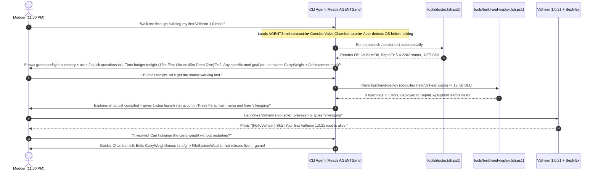
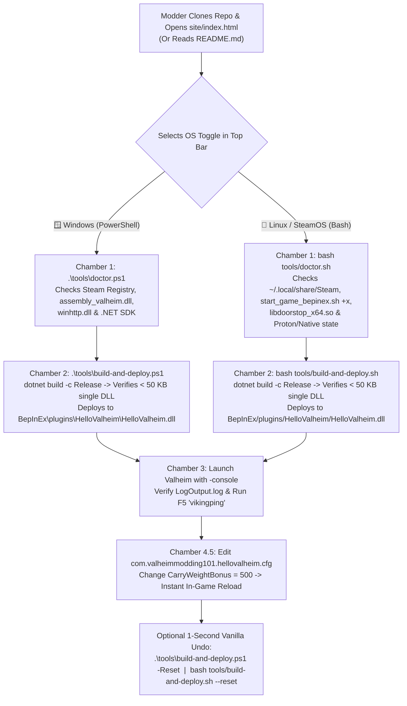
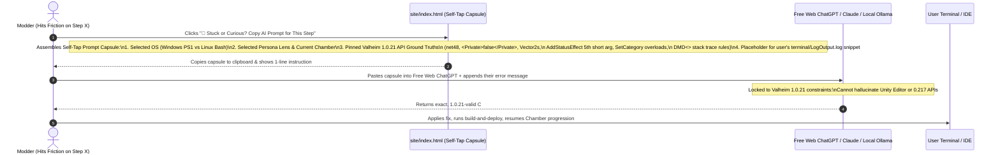
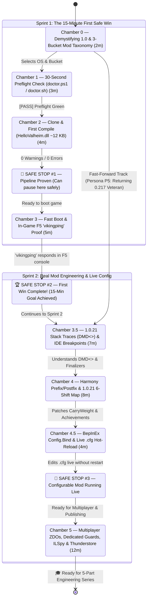

# 03 — End-to-End User Flows & The 8-Chamber State Machine

> **Purpose:** This document defines the exact interaction topologies for our three entry modalities (**Flow A: Autonomous CLI Agent**, **Flow B: Manual No-AI CLI & Visual**, and **Flow C: The 1-Click Self-Tap Web AI Recovery Loop**) alongside the **Flow D: 8-Chamber Progression State Machine**.

---

## Flow A: Clone & Point a CLI Agent (`AGENTS.md` Autonomous Guided Loop)

This flow serves **AI-3 (Frontier CLI Agents: Claude Code, Codex, Cursor, Windsurf, Antigravity)** and **AI-2 (Local GPU Agents: Ollama / vLLM with `qwen2.5-coder`)**. The user clones the repository and says a single sentence: *"Walk me through building my first Valheim 1.0 mod."*

### Why Flow A Works Without Drift
1. **Zero Guessing on Paths:** Instead of hallucinating where Steam or `.NET` is installed, `AGENTS.md` instructs the agent to execute `tools/doctor.sh` or `tools/doctor.ps1` on Turn 1.
2. **Enforced Guardrails:** The agent is explicitly barred from omitting `<Private>false</Private>`, targeting `net8.0`, or using pre-1.0 signatures (`Vector2i`, 4-arg `AddStatusEffect`).
3. **Paced by User Battery:** The agent pauses at **Safe Stop #1 (Chamber 2)** and **Safe Stop #2 (Chamber 3)** rather than dumping 500 lines of unsolicited C# refactoring.

---

## Flow B: Manual No-AI Track (Windows PowerShell & Linux Bash Side-by-Side)

This flow serves **AI-0 ($0 AI Spend / Pure Deterministic CLI & Visual)** users who want rock-solid scripts and zero AI dependencies. Every step in `site/index.html` and `README.md` pairs Windows PowerShell and Linux Bash commands with identical semantics and exit codes:

---

## Flow C: The "Self-Tap AI Recovery Loop" ($0 Spend Free Web ChatGPT / Claude)

When a learner without a paid CLI agent hits an unexpected error (e.g., a custom C# edit fails to compile, or another mod in their profile conflicts in `LogOutput.log`), asking standard Free Web ChatGPT usually fails because the browser LLM assumes Valheim `0.217` (2022–2023) APIs.

**Our Solution:** Every chamber in the web workbench (`site/index.html`) features a **🤖 Copy Self-Tap AI Prompt** button that constructs a precision-engineered context capsule on the clipboard:

### Anatomy of a Self-Tap Prompt Capsule
Each generated prompt capsule contains four mandatory blocks:
1. **Role & Version Lock:** `"You are assisting me with Valheim 1.0.21 (Deep North) modding using BepInEx 5.4.2202, HarmonyX 2.9.0, and .NET Framework 4.8 (net48). Do NOT suggest Unity Editor workflows or pre-1.0 signatures."`
2. **Step State & File Map:** Exact path (`starter-mod/HelloValheimPlugin.cs`) and the active lesson code for that chamber.
3. **1.0.21 Ground-Truth Guardrails:** Reminders of `<Private>false</Private>`, `Player.m_localPlayer == null` guards, `Utils.persistantDataPath` in `Awake()`, and the 6 architectural shifts.
4. **User Slot:** `"Here is what I am trying to do / the exact output from my terminal or BepInEx/LogOutput.log: [PASTE HERE]"`

---

## Flow D: The 8-Chamber Progression State Machine

The tutorial is structured as an 8-chamber state machine (`0`, `1`, `2`, `3`, `3.5`, `4`, `4.5`, `5`) with three explicit **Safe Stop states** and fast-forward bypass edges for returning `0.217` veterans (`Persona P5`):

---

## State Persistence & Zero-Friction Resume Contract

In the interactive web workbench (`site/app.js`), user state is persisted automatically to `localStorage` under a clean schema (`valheim_modding_101_state_v2`):
- **`os`:** `"windows"` | `"linux"` (auto-detected from `navigator.userAgent` / `navigator.platform` on first load, overridable with 1 click).
- **`persona`:** `"p1-modder"` | `"p2-dev"` | `"p3-hobbyist"` | `"p4-explorer"` | `"p5-veteran"` (dynamically tailors the *"Why This Matters to You"* callout in every chamber).
- **`traction`:** `"cli"` | `"visual"` | `"agent"` | `"web-ai"` (controls default tab emphasis).
- **`layout`:** `"auto"` | `"ultrawide"` | `"halfsnap"` | `"reading"` (allows manual override of viewport responsive breakpoints).
- **`completedChambers`:** Array of completed chamber IDs (`["0", "1", "2", "3"]`) so a tired user who stops at **Safe Stop #2** on Tuesday night can reopen the page on Saturday morning and resume immediately at **Chamber 3.5**.
