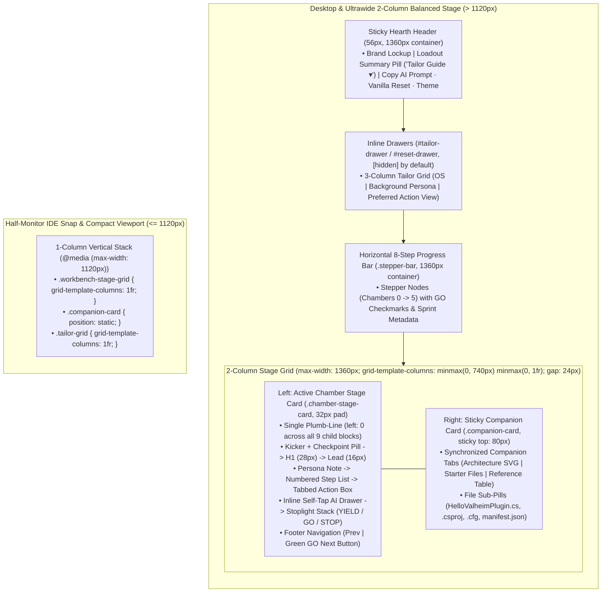

# 04 — Prosumer Responsive & Viking Hearth + Stoplight Design System Specification (v2)

> **Target Hardware & Ergonomic Reality:** PC game modders work at night on 1440p/4K monitors or ultrawides with their browser either full-screen or snapped `50%` beside VS Code, JetBrains Rider, ILSpy, or a terminal. Version 2 replaces noisy multi-rail neon chrome with the **Viking Hearth & Strict 3-Color Stoplight Design System**: a disciplined **5-token modular type scale**, a **single-plumb-line active chamber card**, a **synchronized sticky companion card**, and **inline drawers (zero modal overlays)**.

---

## 1. Responsive Breakpoint & Container Architecture

All top-level horizontal bars (`.hearth-header-inner`, `.inline-drawer-inner`, `.stepper-bar-inner`, and `.workbench-stage-grid`) share an identical outer container alignment (`max-width: 1360px; margin: 0 auto; padding: 0 24px;`) so left and right vertical edges align to a single outer plumb-line across the viewport.

### Breakpoint Rules
1. **Desktop & Ultrawide (`> 1120px`):**
   - `.workbench-stage-grid` renders `grid-template-columns: minmax(0, 740px) minmax(0, 1fr); gap: 24px; align-items: start;`.
   - `.chamber-stage-card` (`max 740px`) maintains an optimal reading measure (`60ch–72ch`) with a strict single internal plumb-line (`padding: 32px; gap: 24px;`).
   - `.companion-card` remains `position: sticky; top: 80px;` in the right column so architecture diagrams, starter mod source files, and reference tables stay in sight while scrolling the active chamber.
2. **50% Half-Screen IDE Snap & Compact Mode (`@media (max-width: 1120px)`):**
   - `.workbench-stage-grid` collapses cleanly to `grid-template-columns: 1fr;` with zero horizontal overflow.
   - `.companion-card` switches to `position: static;` directly beneath the active chamber card.
   - `.tailor-grid` collapses from `repeat(3, 1fr)` to `1fr`.

---

## 2. Mandatory 5-Token Modular Type Scale

To eliminate visual clutter and sub-pixel sizing drift, **only 5 font sizes exist across the entire application** (`12px`, `14px`, `16px`, `20px`, `28px`). Automated Playwright verification queries `getComputedStyle(el).fontSize` across every visible HTML element and enforces that zero other font sizes appear.

| CSS Custom Property | Computed Size | Line Height | Assigned UI Elements & Semantic Scope |
| :--- | :--- | :--- | :--- |
| `--font-xs` | `12px` | `16px` | Uppercase kickers (`.chamber-kicker`, `.tailor-col-title`), `.brand-tag`, `.checkpoint-pill`, `.stepper-node`, `.stepper-meta`, `.step-num`, `.stoplight-header`, `.file-pill`, `table.chamber-table th`, `<small>` captions. |
| `--font-sm` | `14px` | `22px` | All `pre` & `code` blocks, buttons/pills/tabs (`.loadout-summary-pill`, `.btn-utility`, `.tailor-option-btn`, `.action-tab`, `.btn-action-tool`, `.companion-tab`, `.btn-nav-prev`, `.btn-nav-next-go`), `.persona-inline-note`, `.stoplight-stop summary`, `.stoplight-stop-content`, `.diagram-caption`, `table.chamber-table td`. |
| `--font-md` | `16px` | `26px` | `body` default, `.brand-name`, `.chamber-lead`, `.step-list-item`, `.stoplight-body` (`YIELD` and `GO` verification text). |
| `--font-lg` | `20px` | `28px` | Section headings (`h2`, `h3`), `.drawer-title`, `.companion-title`. |
| `--font-xl` | `28px` | `36px` | Active Chamber primary heading (`h1`, `.chamber-h1`, `font-weight: 700`). |

### Critical Typography Stability Invariants
1. **`pre code` Reset (Zero Line-1 Indent & Zero Nested Shrink):**
   - Inline `code` uses `font-size: var(--font-sm); padding: 2px 6px; background: var(--bg-elevated);`.
   - `pre` uses `font-size: var(--font-sm); line-height: 22px; padding: 16px; margin: 0; white-space: pre-wrap; word-break: break-word;`.
   - `pre code` explicitly resets `font-size: inherit; line-height: inherit; background: transparent; color: inherit; padding: 0; border: 0; border-radius: 0;` so Line 1 of every code block aligns flush left (`0px` extra indent) and remains a crisp `14px`.
2. **Constant `font-weight: 600` on Interactive Controls:**
   - Buttons, tabs, and stepper pills never change `font-weight` between default, `:hover`, and `.active` states (`font-weight: 600` constant), preventing horizontal layout jitter when switching tabs or OS modes.

---

## 3. Viking Hearth Neutral Palette & Strict 3-Color Stoplight System

All decorative rainbow accents are removed. Neutral structural surfaces use **Viking Hearth Slate & Ironstone** (Dark Mode default) and **Nordic Birch Parchment** (Light Mode), paired with **Burnished Hearth Bronze** for active interactive focus and a strict **3-Color Stoplight System** (`GO`, `YIELD`, `STOP`) reserved exclusively for operational verification and safety states.

### Surface, Text & Brand Accent Tokens

| Token Role | CSS Custom Property | Dark Mode (`:root` — Viking Hearth Slate) | Light Mode (`body[data-theme="light"]` — Nordic Birch) |
| :--- | :--- | :--- | :--- |
| **Primary Canvas** | `--bg-canvas` | `#111418` (Deep Basalt) | `#F5F2EB` (Birch Parchment) |
| **Card Surface** | `--bg-card` | `#181C23` (Smoked Ironstone) | `#FFFFFF` (Crisp Paper) |
| **Elevated Control / Well** | `--bg-elevated` | `#212730` (Dressed Slate) | `#EAE5D9` (Warm Stone) |
| **Code & Terminal Surface** | `--bg-code` | `#0C0E12` (Forge Obsidian) | `#14181F` (Recessed Slate) |
| **Standard Hairline Border** | `--border-stone` | `#2B323D` | `#D8D0C2` |
| **Strong Interactive Border** | `--border-strong` | `#3B4454` | `#B8AFA0` |
| **Primary Text** | `--text-primary` | `#F3EFEA` (Warm Bone White) | `#1C1917` (Deep Charcoal) |
| **Secondary Text** | `--text-secondary` | `#B6B0A6` (Weathered Ash) | `#57534E` (Warm Slate) |
| **Muted Metadata Text** | `--text-muted` | `#827B72` (Dim Runestone) | `#78716C` (Muted Stone) |
| **Hearth Bronze Accent** | `--accent-bronze` | `#D4A359` (Burnished Bronze) | `#9A6B28` (Forged Bronze) |
| **Hearth Bronze Tint** | `--accent-bronze-bg` | `rgba(212, 163, 89, 0.12)` | `rgba(154, 107, 40, 0.10)` |
| **Hearth Bronze Border** | `--accent-bronze-border` | `rgba(212, 163, 89, 0.42)` | `rgba(154, 107, 40, 0.38)` |

### Strict 3-Color Stoplight Tokens

| Stoplight Signal | CSS Custom Properties | Dark Mode Values | Light Mode Values | Exclusive Semantic Usage |
| :--- | :--- | :--- | :--- | :--- |
| **🟢 GO** (Proceed / Verified Pass / Safe Checkpoint) | `--go-fg` `--go-bg` `--go-border` | `#22C55E` `rgba(34, 197, 94, 0.10)` `rgba(34, 197, 94, 0.38)` | `#15803D` `rgba(21, 128, 61, 0.08)` `rgba(21, 128, 61, 0.32)` | `.stoplight-go` verification card, `.checkpoint-pill`, `.stepper-node.completed`, `.btn-action-tool.copied`, and `.btn-nav-next-go` primary forward CTA. |
| **🟡 YIELD** (Caution / Prerequisite Check) | `--yield-fg` `--yield-bg` `--yield-border` | `#F59E0B` `rgba(245, 158, 11, 0.10)` `rgba(245, 158, 11, 0.38)` | `#B45309` `rgba(180, 83, 9, 0.08)` `rgba(180, 83, 9, 0.32)` | `.stoplight-yield` prerequisite / caution check card in the Stoplight Verification Stack. |
| **🔴 STOP** (Cliff-Edge Trap / Danger) | `--stop-fg` `--stop-bg` `--stop-border` | `#EF4444` `rgba(239, 68, 68, 0.10)` `rgba(239, 68, 68, 0.38)` | `#B91C1C` `rgba(185, 28, 28, 0.08)` `rgba(185, 28, 28, 0.32)` | `.stoplight-stop` collapsible `
` troubleshooting accordion (*If Something Goes Wrong — Symptom / Cause / 10-Second Fix*). |

---

## 4. Single Plumb-Line & Progressive Disclosure Architecture

1. **Single Internal Plumb-Line in `.chamber-stage-card`:**
   - Every direct child block inside `.chamber-stage-card` (`.chamber-kicker-row`, `.chamber-h1`, `.chamber-lead`, `.persona-inline-note`, `.step-list`, `.action-box`, `.ai-inline-drawer`, `.stoplight-stack`, `.chamber-footer-nav`) has `margin: 0` and starts at `left: 0` relative to the card's `32px` content box, separated by a uniform `gap: 24px`.
2. **Progressive Disclosure via Inline Drawers (Zero Modal Scrims):**
   - `#tailor-drawer` and `#reset-drawer` expand inline below `.hearth-header` using the `[hidden]` attribute, and `.ai-inline-drawer` expands inline inside `.chamber-stage-card` below `.action-box`—never blocking the viewport with a modal backdrop.
3. **Single Tabbed `.action-box`:**
   - Consolidates `Terminal (PowerShell/Bash)`, `C# / Config Source`, and `AI Agent Task` into a single tabbed code surface with 1-click copy feedback (`.btn-action-tool.copied` flashes `--go-fg`) and an inline `Ask AI / Diagnose Error` drawer toggle.
