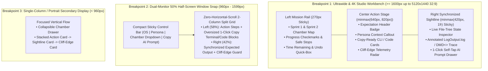

# 04 — Prosumer Ultrawide, Multi-Monitor & Half-Screen Responsive Specification

> **Target Hardware Reality:** Most web documentation is designed for either a 13" MacBook Air or an iPhone screen, wrapping content inside a narrow `720px` center column with `60%` empty whitespace on desktop monitors. **PC game modders are different.** They run high-refresh 1440p/4K dual monitors, `21:9` (`3440x1440`) and `32:9` (`5120x1440`) ultrawides, and—most critically—they **snap the browser window to 50% width (`960px–1599px`)** right next to VS Code, JetBrains Rider, ILSpy, or their terminal.

---

## 1. Responsive Breakpoint Architecture

Our interactive tutorial workbench (`site/styles.css` & `site/index.html`) implements three intentional, purpose-engineered viewport modes with an instant manual layout switcher in the top bar:



---

## 2. Detailed Viewport Specifications

### Breakpoint 1: Ultrawide & 4K Studio Workbench (`>= 1600px`, Optimized up to `5120x1440` `32:9`)
When a user places the tutorial on a dedicated 27"–32" 1440p/4K display or spans an ultrawide monitor (`3440x1440` or `5120x1440`), whitespace is never wasted:
- **CSS Grid Template:**
  ```css
  .workbench-grid {
    display: grid;
    grid-template-columns: 270px minmax(640px, 840px) minmax(420px, 1fr);
    gap: 24px;
    max-width: 2400px;
    margin: 0 auto;
    align-items: start;
  }
  ```
- **Left Mission Rail (`270px`, `position: sticky; top: 76px`):**
  - Displays all 8 Chambers (`0`, `1`, `2`, `3`, `3.5`, `4`, `4.5`, `5`) grouped into **Sprint 1 (15m First Win)** and **Sprint 2 (30m Real Engineering)**.
  - Highlights explicit **🛑 Safe Stopping Points** after Chambers `2`, `3`, and `4.5`.
  - Shows a live completion progress bar and a persistent **1-Command Vanilla Undo** reference card at the bottom of the rail.
- **Center Action Stage (`minmax(640px, 840px)`):**
  - Optimal typographic line measure (`65ch–78ch`) for effortless scanning at 11:30 PM.
  - Starts every step with the **Expectation Header Pill Bar** (`⏱️ Duration`, `🧠 Cognitive Lift`, `🛑 Safe Stop`, `↩️ Undo`).
  - Renders OS-synchronized command blocks (`Windows PowerShell` vs. `Linux Bash`) and annotated C# lessons from `HelloValheimPlugin.cs`.
- **Right Synchronized Sightline Pane (`minmax(420px, 1fr)`, `position: sticky; top: 76px`):**
  - Automatically updates as the user switches chambers or hovers code blocks.
  - Shows the **Expected Terminal / `LogOutput.log` Sightline**, the **Live Directory Tree** (highlighting which files are touched and which are untouched), the **Interactive Architecture Diagram**, and the **🤖 Self-Tap AI Prompt Capsule** preview.

---

### Breakpoint 2: Dual-Monitor 50% Half-Screen Window Snap (`960px – 1599px`)
This is the **#1 active coding viewport**: the user snaps VS Code, JetBrains Rider, or Windows Terminal / Kitty to the left half of their screen (`960px` on 1080p, `1280px` on 1440p, `1720px` on `3440x1440`) and snaps the browser to the right half.
- **Design Rules for 50% Window Snap:**
  1. **Collapse Left Navigation into a Compact Top Step Pill Bar:** Frees `270px` of horizontal real estate immediately so code and terminal commands never clip.
  2. **Zero Horizontal Scroll in Code & Terminal Blocks:**
     - Long CLI paths and PowerShell/Bash pipelines use clean multi-line continuations (`\` on Bash, `` ` `` on PowerShell) and `white-space: pre-wrap; word-break: break-word` fallback so the user never has to horizontal-scroll with a mouse while coding.
  3. **Oversized 1-Click Copy Targets (`min-height: 36px`, High-Contrast Feedback):**
     - Every command block and C# snippet has a top-right **📋 Copy Command** button that flashes emerald green (`✓ Copied!`) so the user can move their cursor from Browser -> Terminal in `< 0.5 seconds`.
  4. **2-Column Split Inside the Stage (`58% Action / 42% Sightline` at `1150px–1599px`, `100% Stacked` at `960px–1149px`):**
     - Keeps the action command and its expected verification output visible side-by-side without vertical scrolling back and forth.

---

### Breakpoint 3: Portrait Secondary Display / Compact Mode (`< 960px`)
Many developers mount a secondary monitor in **vertical portrait orientation (`1080x1920` or `1440x2560`)** for documentation, or view the guide on a Steam Deck / tablet beside their desktop PC:
- Stacks the Action Card, Expected Sightline Card, and Cliff-Edge Telemetry Box in a clean vertical sequence with sticky top OS/Chamber controls and a bottom quick-jump bar (`← Prev Chamber` | `🤖 Copy AI Prompt` | `Next Chamber →`).

---

## 3. Stitch Sovereign Visual & Typography Tokens

To ensure crystal-clear legibility in dimly lit rooms at 11:30 PM (while also offering a high-contrast daylight theme toggle), the workbench uses the **Stitch Sovereign Norse Forge** token palette:

| Token Role | CSS Custom Property | Dark Mode Value (Default) | Light Mode Value | Purpose & Ergonomic Rationale |
| :--- | :--- | :--- | :--- | :--- |
| **Primary Canvas** | `--bg-canvas` | `#090D16` (Deep Obsidian Slate) | `#F8FAFC` | Eliminates pure-black (`#000000`) OLED halation on ultrawide displays while reducing eye strain at night. |
| **Elevated Card Surface** | `--bg-surface` | `#111827` | `#FFFFFF` | Creates clear card boundaries for Action Steps and Sightline Panels. |
| **Code & Terminal Well** | `--bg-code` | `#060911` | `#0F172A` | High-contrast recessed terminal surface with `1px solid rgba(56, 189, 248, 0.18)` border. |
| **Primary Text** | `--text-primary` | `#F1F5F9` (`95%` Luminance) | `#0F172A` | Crisp readability at `15.5px` (`line-height: 1.65`). |
| **Secondary / Muted Text** | `--text-secondary` | `#94A3B8` | `#475569` | Used for secondary explanations and metadata labels. |
| **Valheim Frost Cyan (Primary Accent)** | `--accent-cyan` | `#38BDF8` | `#0284C7` | Interactive active states, links, and *Deep North* `1.0.20` structural highlights. |
| **BepInEx Hearth Amber (Focus / Config)** | `--accent-amber` | `#F59E0B` | `#D97706` | Highlights `Expectation Headers`, `Safe Stopping Points`, and `ConfigEntry<T>` lessons. |
| **Sightline Emerald (Pass / Verified)** | `--status-pass` | `#10B981` | `#059669` | Used exclusively for **Green Sightline** verification outputs and `✓ Copied` confirmations. |
| **Cliff-Edge Crimson (Danger / Fix)** | `--status-cliff` | `#F43F5E` | `#E11D48` | Used exclusively for **Cliff-Edge Telemetry Boxes** (*Where Missteps Go Poorly*). |
| **Monospace Font Stack** | `--font-mono` | `'JetBrains Mono', 'Fira Code', 'Cascadia Code', monospace` | Same | Enforces `font-variant-numeric: tabular-nums` so assembly sizes, IL offsets (`IL_005B`), and timings align cleanly. |

---

## 4. Interactive Ergonomic Features Required in `site/`

1. **Instant Loadout Bar (Sticky Top Header):**
   - **OS Toggle:** `🪟 Windows (PowerShell)` | `🐧 Linux / SteamOS (Bash)` — switches every terminal block, file path (`\` vs `/`), and Doorstop explanation (`winhttp.dll` vs `start_game_bepinex.sh`) page-wide in `< 16ms`.
   - **Persona Lens Selector:** `🔄 Cross-Game Modder (P1)` | `💻 Software Dev (P2)` | `🎯 Hobbyist (P3)` | `🧭 Explorer (P4)` | `⚡ Returning 0.217 Veteran (P5)` — dynamically swaps the top *"Why This Step Matters For Your Background"* callout in every chamber.
   - **Layout Mode Override:** `🖥️ Auto / Ultrawide 3-Pane` | `🌗 50% Half-Screen Snap` | `📱 Single Column` — lets users preview or lock any breakpoint regardless of current window width.
2. **Keyboard Navigation for Fast Coding Loops:**
   - `[` / `]` or `Alt+Left` / `Alt+Right`: Step backward / forward between Chambers `0` through `5`.
   - `w` / `l`: Quick-toggle Windows PowerShell vs. Linux Bash commands.
   - `a`: Open/copy the current Chamber's **🤖 Self-Tap AI Prompt Capsule**.
3. **Zero External Runtime Dependencies:**
   - Works `100%` offline via `file:///home/derek/work/valheim-modding-101/site/index.html`, local `python3 -m http.server`, or GitHub Pages—no npm build step or external CDN required to view or interact with any diagram, filter, or prompt capsule.
